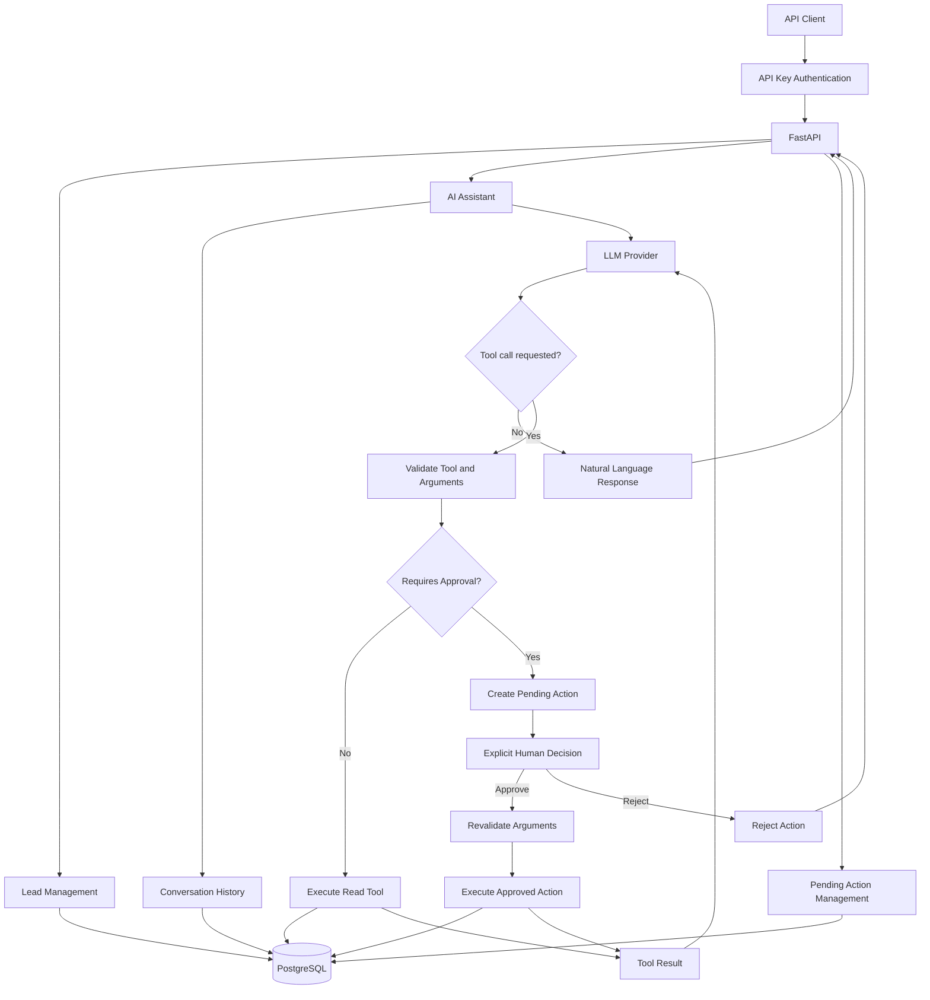
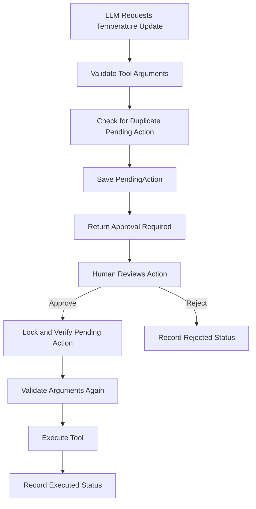

# Lead Capture API

A backend API built with **Python, FastAPI, PostgreSQL, and Large Language Models (LLMs)** to capture, validate, store, and classify potential clients.

The project also includes an AI assistant capable of calling backend tools, retrieving real database information, maintaining bounded conversation history, estimating LLM usage costs, and requesting explicit human approval before executing sensitive actions.

This project is part of my **Road to Agentic AI** portfolio, focused on backend development, AI integration, tool calling, and human-in-the-loop (HITL) systems.

## Table of Contents

- [Features](#features)
- [Architecture](#architecture)
- [Technology Stack](#technology-stack)
- [API Endpoints](#api-endpoints)
- [AI Assistant and Tool Calling](#ai-assistant-and-tool-calling)
- [Available Tools](#available-tools)
- [Human-in-the-Loop Safety](#human-in-the-loop-safety)
- [Conversation History](#conversation-history)
- [LLM Usage and Cost Estimation](#llm-usage-and-cost-estimation)
- [Error Handling](#error-handling)
- [Installation and Setup](#installation-and-setup)
- [Testing](#testing)
- [Security Considerations](#security-considerations)
- [Project Goals](#project-goals)

## Features

- **Lead management:** Create, retrieve, list, and update leads.
- **AI-powered classification:** Use an LLM to classify incoming leads.
- **Database persistence:** Store leads, conversations, and pending actions in PostgreSQL.
- **AI tool calling:** Allow the assistant to request backend operations through predefined tools.
- **Validated tool arguments:** Validate model-generated arguments before executing backend functions.
- **Human-in-the-loop approval:** Require explicit approval before executing sensitive temperature updates requested through the assistant.
- **Duplicate approval prevention:** Check for equivalent pending requests before creating another pending action.
- **Conversation memory:** Retrieve previous messages using a conversation ID and limit the history sent to the LLM.
- **Token usage logging:** Record token usage and estimated LLM costs in application logs.
- **Database migrations:** Manage database schema changes with Alembic.
- **Containerization:** Run the API and PostgreSQL using Docker Compose.
- **Automated testing:** Test backend behavior with pytest.

## Architecture

### System overview



### Tool-calling lifecycle

The LLM does not directly access the database or execute Python functions. It requests a tool call, and the backend determines whether and how that request can be executed.

1. The client sends a question to the assistant.
2. The backend retrieves the conversation history and sends the messages and tool definitions to the LLM.
3. The LLM returns either a regular response or a tool-call request.
4. The backend validates the tool name and arguments.
5. The backend executes permitted read operations or creates a pending action for operations requiring approval.
6. The result is returned to the LLM for a natural language response when applicable.
7. The API returns the response to the client.

## Technology Stack

| Technology     | Purpose                              |
| -------------- | ------------------------------------ |
| Python         | Backend programming language         |
| FastAPI        | REST API framework                   |
| PostgreSQL     | Relational database                  |
| SQLAlchemy     | Database ORM                         |
| Alembic        | Database schema migrations           |
| Pydantic       | Request and tool argument validation |
| Groq API       | LLM inference and tool calling       |
| Docker         | Application containerization         |
| Docker Compose | Local multi-container environment    |
| pytest         | Automated testing                    |

## API Endpoints

All endpoints require API key authentication using the `X-API-Key` header.

| Method  | Endpoint                                    | Description                         |
| ------- | ------------------------------------------- | ----------------------------------- |
| `POST`  | `/leads`                                    | Create and classify a lead          |
| `GET`   | `/leads`                                    | Retrieve a paginated list of leads  |
| `GET`   | `/leads/{id}`                               | Retrieve a lead by ID               |
| `PATCH` | `/leads/{id}`                               | Update lead fields                  |
| `POST`  | `/assistant/ask`                            | Send a question to the AI assistant |
| `GET`   | `/actions/{action_status}`                  | List actions by status              |
| `POST`  | `/pending_actions/{action_id}/{new_status}` | Approve or reject a pending action  |

Interactive API documentation is available through FastAPI's Swagger UI at `/docs` when the application is running.

### 1. Create a lead

`POST /leads`

Creates a lead, stores it in PostgreSQL, and attempts to classify it using an LLM.

The API rejects requests that attempt to provide an initial temperature directly through this endpoint. If classification fails, the lead is stored with a pending classification status.

### 2. List leads

`GET /leads?pages=1&limit=10`

Returns a paginated list of leads.

- `pages`: Page number, starting at 1.
- `limit`: Number of records per page, from 1 to 100.

### 3. Retrieve a lead

`GET /leads/{id}`

Returns a lead by its identifier.

### 4. Update a lead

`PATCH /leads/{id}`

Updates supported lead fields.

**Safety note:** This general-purpose endpoint can update the temperature directly. It does not use the assistant's pending-action approval flow. Protect this endpoint appropriately if every temperature change must require human approval.

### 5. Ask the AI assistant

`POST /assistant/ask`

Sends a message to the LLM-powered assistant. The request may include a conversation ID to continue an existing conversation.

Example request:

```json
{
  "message": "How many hot leads do we have?"
}
```

To continue a conversation, include the existing `conversation_id` in the request.

The exact response depends on whether the assistant returns a regular answer, requests a tool call, or encounters an error.

### 6. List actions by status

`GET /actions/{action_status}?pages=1&limit=10`

Retrieves actions filtered by status.

Supported status values:

- `pending`
- `executed`
- `rejected`

Example:

```http
GET /actions/pending?pages=1&limit=10
```

### 7. Approve or reject a pending action

Approve an action:

```http
POST /pending_actions/{action_id}/approve
```

Reject an action:

```http
POST /pending_actions/{action_id}/reject
```

The backend checks that the action exists and is still pending. When approved, it validates the stored arguments again before executing the corresponding tool. When rejected, the requested operation is not executed.

## AI Assistant and Tool Calling

The assistant uses LLM tool calling to interact with backend capabilities through a predefined tool registry.

Tool definitions describe the available functions and their argument schemas. The LLM can request a tool call, but the backend remains responsible for validation, authorization, execution, and database access.

### Example questions

The assistant is designed to handle questions such as:

- "How many leads are classified as hot?"
- "How many leads were created in the last 7 days?"
- "Find the lead associated with [juan@example.com](mailto\:juan@example.com)."
- "Request a temperature change for lead 12 to hot."

These examples depend on the actual tool schemas, supported arguments, and implemented database queries.

### Available tools

| Tool                      | Purpose                                                                                | Approval required |
| ------------------------- | -------------------------------------------------------------------------------------- | ----------------- |
| `get_lead_stats`          | Retrieve lead statistics using supported filters, such as temperature and a date range | No                |
| `get_lead_by_email`       | Retrieve a lead using its email address                                                | No                |
| `update_lead_temperature` | Request a change to a lead's temperature                                               | Yes               |

The precise supported argument values are defined by the corresponding Pydantic schemas and tool implementations.

### Backend execution flow

The tool execution layer follows this general sequence:

1. Look up the requested tool in `TOOL_REGISTRY`.
2. Reject unknown tool names.
3. Validate arguments using the tool's Pydantic model.
4. Check whether the operation requires approval.
5. Execute the function or create a pending action.
6. Return the result to the assistant.

This architecture keeps tool selection separate from tool execution: the model proposes an operation, while the backend controls its execution.

## Human-in-the-Loop Safety

The `update_lead_temperature` tool is configured to require confirmation.

A request from the LLM is **not authorization to execute the operation**.

### Approval workflow



### Approval safeguards

- The tool registry marks temperature updates as requiring confirmation.
- The backend validates the proposed arguments before creating a pending action.
- Equivalent pending requests are checked to reduce duplicate approval requests.
- The action is stored in the database with a pending status.
- An explicit approval or rejection is required through the action-management endpoint.
- Approval processing checks the current status and uses a database row lock.
- Arguments are validated again before an approved operation is executed.
- Rejected actions are not executed through the approval workflow.

The database lock and status checks help prevent concurrent processing of the same pending action. They should not be interpreted as a guarantee of exactly-once execution in every failure scenario.

### Important limitation

The general `PATCH /leads/{id}` endpoint can update lead temperature without using this workflow. Therefore, the HITL guarantee applies to updates requested through the assistant's tool execution path, not automatically to every way of modifying a lead.

## Conversation History

The assistant supports conversation continuity through a conversation ID.

The intended lifecycle is:

1. Receive a message, optionally with a conversation ID.
2. Retrieve the corresponding conversation and its stored history.
3. Limit the history sent to the LLM using `MAX_HISTORY_MESSAGES`.
4. Add the current user message.
5. Process the LLM response and any tool calls.
6. Persist the resulting conversation messages.

This allows the assistant to use recent conversational context without sending the entire conversation on every request.

Conversation history is bounded to control context size and reduce unnecessary token consumption.

## LLM Usage and Cost Estimation

The application includes token usage logging and estimated cost calculations for LLM calls.

The cost logger uses configured input, cached-input, and output rates to estimate the cost of a request. When a request requires multiple LLM calls, the assistant accumulates the estimates for those calls.

### Configured pricing rates

The current values in the implementation are:

| Token category      | Configured rate per 1 million tokens |
| ------------------- | -----------------------------------: |
| Input tokens        |                                $0.15 |
| Cached input tokens |                               $0.075 |
| Output tokens       |                                $0.60 |

**These are the rates currently hardcoded in the application, not a guarantee of the provider's current prices.** Verify the pricing for the exact model configured in `GROQ_MODEL` before using these values for financial reporting.

### Cost-per-request examples

The following examples illustrate the calculation using the configured rates. They are estimates, not measured production requests.

| Example request                                   | Input tokens | Cached input tokens | Output tokens | Estimated cost |
| ------------------------------------------------- | -----------: | ------------------: | ------------: | -------------: |
| Short text response                               |        1,000 |                   0 |           300 |       $0.00033 |
| Response with cached input                        |        1,000 |               1,000 |           300 |      $0.000255 |
| Longer response                                   |        5,000 |                   0 |         1,000 |       $0.00135 |
| Tool-calling request, illustrative two-call total |        3,000 |                   0 |           600 |       $0.00081 |

The final row represents a hypothetical total of 3,000 input tokens and 600 output tokens across two LLM calls. Actual tool-calling costs depend on the number of model calls, conversation history, tool results, and generated responses.

### Calculation

For the configured rates, the basic estimate is:

```text
estimated_cost =
    (input_tokens / 1_000_000 * 0.15)
    + (cached_input_tokens / 1_000_000 * 0.075)
    + (output_tokens / 1_000_000 * 0.60)
```

Use the token categories and rates reported by the provider and supported by the configured model. Do not count the same input tokens twice when cached tokens are already included in the total input count.

### Logging versus persistence

The current implementation logs token usage and estimated costs through the application's logging system. It also accumulates costs across the LLM calls made during an assistant request.

This does **not** mean the application currently stores a dedicated cost record for every request in a database table. Persistent per-request cost analytics would require an additional storage and reporting implementation.

## Error Handling

The API uses HTTP errors and backend validation to handle common failure scenarios.

| Scenario                      | Expected handling                                                            |
| ----------------------------- | ---------------------------------------------------------------------------- |
| Lead does not exist           | `404 Not Found`                                                              |
| Duplicate lead data           | `409 Conflict`                                                               |
| Invalid request parameters    | Request validation error                                                     |
| Unknown tool                  | Backend rejection; LLM correctly informs the tool does not exist             |
| Invalid tool arguments        | Backend validation failure; Informs the args ar not valid for request        |
| Pending action does not exist | `404 Not Found`                                                              |
| Action is no longer pending   | `409 Conflict`                                                               |
| Invalid action decision       | Request validation error                                                     |
| LLM provider failure          | Application error handling and logging                                       |

Tool validation failures should be converted into controlled, structured responses rather than escaping as unhandled exceptions. The exact HTTP response depends on the endpoint's exception handling.

## Installation and Setup

### Prerequisites

- Python 3.13 or a compatible version supported by the project.
- Docker and Docker Compose.
- A Groq API key.
- Git.

### 1. Clone the repository

```bash
git clone https://github.com/SoyColde/lead_capture_api.git
cd lead_capture_api
```

### 2. Configure environment variables

Create a local `.env` file using the variable names expected by the application and Docker Compose configuration.

At minimum, configure the database connection, API key authentication, Groq API credentials, and the model name as required by the source code.

Do not commit `.env` files, API keys, database passwords, or other secrets to GitHub.

### 3. Start the application

If the repository's Docker Compose configuration defines the `api` and `db` services, start them with:

```bash
docker compose up --build -d
```

Check the running containers:

```bash
docker compose ps
```

Inspect application logs:

```bash
docker compose logs -f api
```

### 4. Apply database migrations

Run the migrations using the project's configured Alembic environment:

```bash
docker compose exec api alembic upgrade head
```

If migrations are automatically applied by the container entrypoint, verify the entrypoint behavior before running this command separately.

### 5. Open the API documentation

With the application running locally, visit:

```text
http://localhost:8000/docs
```

Use the authentication mechanism configured by the application when testing protected endpoints.

## Testing

The project uses pytest for automated testing.

Run the full test suite inside the API container:

```bash
docker compose exec api python -m pytest -v
```

To run a specific test module:

```bash
docker compose exec api python -m pytest codigo_fuente/tests/test_execute_tool.py -v --import-mode=importlib
```

The second command assumes the test module is located at that path in the repository.

### Recommended test coverage

- Lead creation and validation.
- Duplicate email and phone handling.
- Lead retrieval and pagination.
- Tool registry lookup.
- Valid and invalid tool arguments.
- Unknown tool handling.
- Creation of pending actions for sensitive operations.
- Duplicate pending-action prevention.
- Explicit approval and rejection.
- Prevention of processing an action that is no longer pending.
- Conversation ID reuse and bounded history.
- Token usage and estimated cost calculations.
- LLM failures and malformed tool-call arguments.

For HITL tests, verify that requesting a temperature update does not change the lead before approval and that rejecting the request leaves the lead unchanged.

## Security Considerations

- Keep API keys and provider credentials in environment variables or a dedicated secrets manager.
- Require authentication for protected API endpoints.
- Validate user input and LLM-generated tool arguments on the backend.
- Do not treat LLM output as trusted executable code.
- Require explicit approval for sensitive tool operations.
- Revalidate pending-action arguments before execution.
- Use database transactions and appropriate locking for action processing.
- Avoid logging secrets or unnecessary personal data.
- Review direct update endpoints to ensure they enforce the intended business rules.
- Convert internal exceptions into safe, structured API responses.

The current approval metadata records an authenticated API-key context. It should not be interpreted as a complete individual-user identity or role-based authorization system.

## Project Goals

This project is a practical step toward building reliable AI-powered backend systems and agentic applications.

The main learning objectives are:

- Building REST APIs with FastAPI.
- Designing database-backed services with PostgreSQL and SQLAlchemy.
- Managing schema evolution with Alembic.
- Integrating LLMs into real application workflows.
- Implementing tool calling with backend-controlled execution.
- Designing human-in-the-loop approval workflows.
- Managing bounded conversational context.
- Estimating token usage costs.
- Testing backend behavior and failure scenarios.
- Documenting software architecture and API contracts.

**Author:** Colde
**GitHub:** [SoyColde](https://github.com/SoyColde)
**Project:** [Lead Capture API](https://github.com/SoyColde/lead_capture_api)
